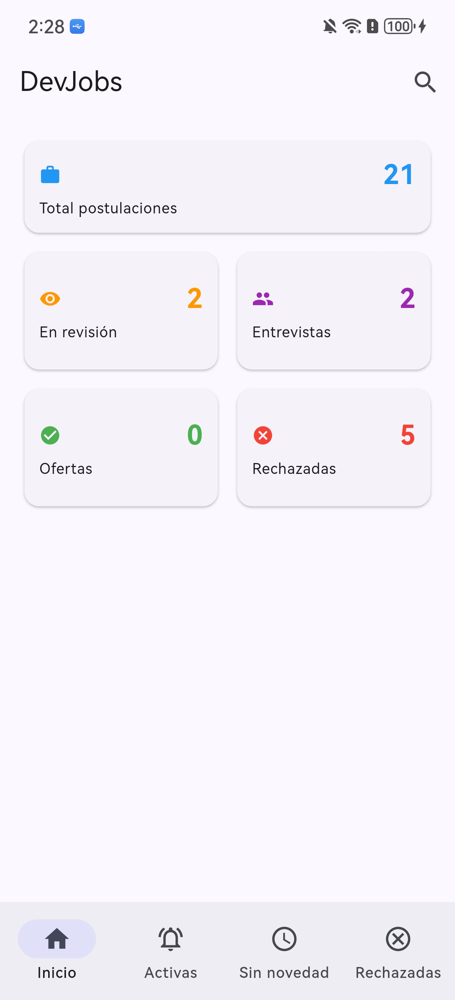
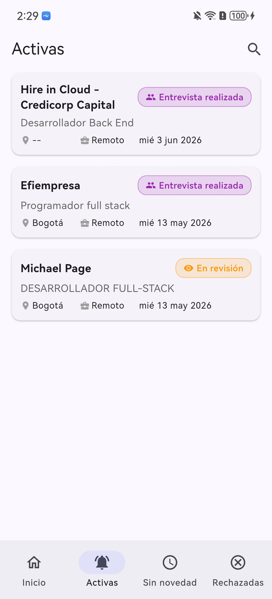
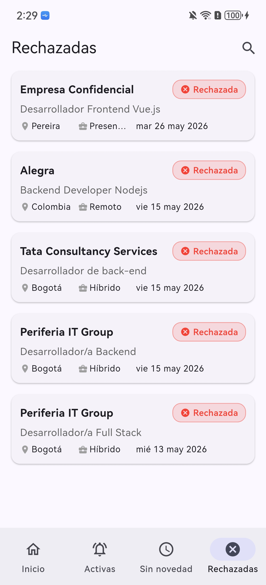
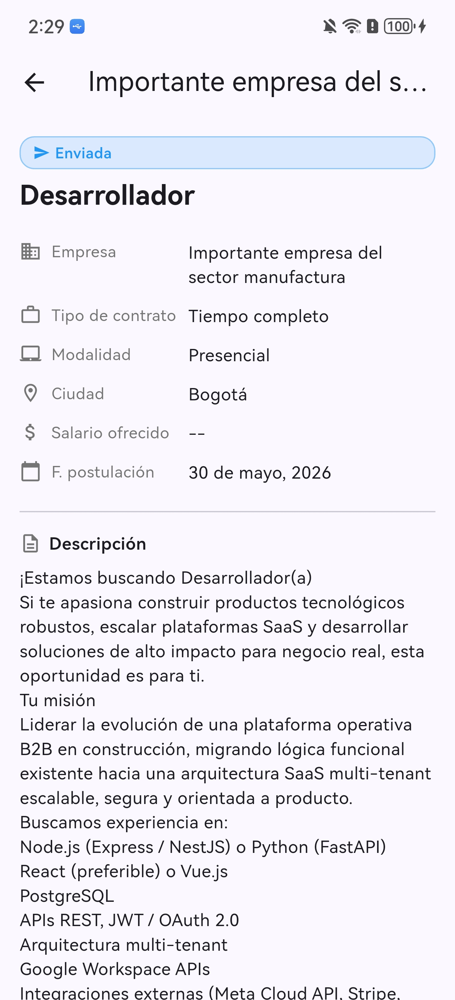

# 💼 DevJobs

Aplicación Flutter para el seguimiento de postulaciones laborales. Conectada a Google Sheets vía Apps Script como backend, permite registrar, filtrar y dar seguimiento a ofertas de empleo con dashboard de métricas interactivas, estados personalizados, indicador de entrevista realizada (checkbox), tiempo del proceso y búsqueda global.

## 📸 Capturas

| | | |
|---|---|---|
|  |  |  |
|  |  | |

## 🛠️ Requisitos

| Herramienta | Versión |
|-------------|---------|
| Flutter | 3.44.1 |
| Dart (pubspec constraint) | `^3.12.1` |
| Dart (bundled) | 3.12.1 |
| DevTools | 2.57.0 |

- Dispositivo o emulador configurado para ejecución física
- Conexión a internet para `flutter pub get`

## 📦 Dependencias

| Paquete | Versión | Propósito |
|---------|---------|-----------|
| `flutter` | SDK | Framework UI multiplataforma |
| `http` | `^1.6.0` | Cliente HTTP para consumir la API REST del Apps Script |
| `provider` | `^6.1.5+1` | Estado global con `ChangeNotifier` (caché, pestañas, filtros) |
| `intl` | `^0.20.2` | Formateo de fechas en español |
| `flutter_dotenv` | `^6.0.1` | Carga de variables de entorno desde archivo `.env` |
| `flutter_lints` (dev) | `^6.0.0` | Reglas de lint por defecto de Flutter |

## 📱 Permisos

| Permiso | Android | Propósito |
|---------|---------|-----------|
| `INTERNET` | ✅ Requerido | Llamadas HTTP al Apps Script (Google Sheets) |

La app requiere permiso de **Internet** para comunicarse con la API REST del Apps Script. Este permiso se declara en `android/app/src/main/AndroidManifest.xml` y se incluye automáticamente en el APK.


## 🚀 Comandos

| Acción | Comando |
|--------|---------|
| Ejecutar (debug) | `flutter run` |
| Ejecutar (release) | `flutter run --release` |
| Analizar código | `flutter analyze` |
| Ejecutar tests | `flutter test` |
| Obtener paquetes | `flutter pub get` |
| Limpiar build | `flutter clean` |
| Build Android (APK) | `flutter build apk --release` |
| Build Windows | `flutter build windows --release` |

## 📱 Seleccionar dispositivo

Listar dispositivos conectados y emuladores:

```bash
flutter devices
```

Ejecutar en un dispositivo específico:

```bash
flutter run -d <device_id>
```

Ejemplos:

```bash
flutter run -d chrome        # Navegador web
flutter run -d emulator-5554 # Emulador Android
flutter run -d macos         # macOS (desktop)
flutter run -d ios           # iOS simulator
```

## 📦 Despliegue

Todos los artefactos quedan dentro de `build/` (carpeta ignorada por git — se regenera con cada build).

### Android — APK / App Bundle

```bash
flutter build apk --release
# Salida: build\app\outputs\flutter-apk\app-release.apk  (~50 MB)

flutter build appbundle
# Salida: build\app\outputs\bundle\release\app-release.aab
```

Instalar directamente en un dispositivo/emulador conectado (sin pasar por el archivo):

```bash
flutter install --release                    # dispositivo único conectado
flutter install --release -d <device_id>     # dispositivo específico (ver `flutter devices`)
```

### Windows

La plataforma Windows debe estar habilitada (carpeta `windows/` en la raíz del proyecto). Si no existe:

```bash
flutter create --platforms=windows .
```

Build de release:

```bash
flutter build windows --release
# Salida: build\windows\x64\runner\Release\devjobs.exe
```

La app abre en una **ventana de 420×880 centrada** (diseño mobile-first; es redimensionable) y su ícono se genera desde `assets/icon/icon.png` con `flutter_launcher_icons` (config `windows.generate` en `pubspec.yaml`; regenerar con `dart run flutter_launcher_icons`).

> ⚠️ Para distribuir o mover la app hay que copiar **toda la carpeta** `build\windows\x64\runner\Release\` (el `.exe` + DLLs + carpeta `data\`), no solo el `devjobs.exe`. Para una PC sin Flutter, comprime esa carpeta y en la destino ejecuta `devjobs.exe`.

Para probar en local sin compilar: `flutter run -d windows`.

#### Instalador — Inno Setup (opcional)

Para generar un `DevJobsSetup.exe` con acceso directo en Escritorio/Menú Inicio y desinstalador:

1. Instala **Inno Setup 6+** (gratis): <https://jrsoftware.org/isinfo.php>
2. Compila la app: `flutter build windows --release`
3. Genera el instalador:

```bash
"C:\Program Files (x86)\Inno Setup 6\ISCC.exe" installer\devjobs.iss
# Salida: installer\Output\DevJobsSetup.exe
```

El script es [`installer/devjobs.iss`](installer/devjobs.iss) (incluye nombre, versión, ícono y tareas de acceso directo). Sin Inno Setup instalado, la app se distribuye igual en portable (paso anterior).

### Web

```bash
flutter build web
# Salida: build\web\
```

### iOS (requiere macOS)

```bash
flutter build ios
# Salida: build\ios\iphoneos\Runner.app
```

### macOS

```bash
flutter build macos
# Salida: build\macos\Build\Products\Release\
```

> 📝 El `.env` (con `API_URL`) se embebe en el bundle durante el build — asegúrate de tenerlo configurado antes de compilar cualquier plataforma.

## 🧪 Tests

```bash
# Todos los tests
flutter test

# Tests de un archivo específico
flutter test test/widget_test.dart
```

## 🧹 Linter

El proyecto usa `flutter_lints` con la configuración por defecto de Flutter.

```bash
flutter analyze
```

## 📊 Google Sheets como fuente de datos

La app se conecta a una **Google Sheet** como backend. No necesita servidor propio — usa un **Google Apps Script** desplegado como Web App que actúa como API REST (lectura y escritura).

| Pestaña | Contenido |
|---------|-----------|
| **Dashboard** | Resumen con totales: postulaciones, activas, entrevistas (vía checkbox), rechazadas. Cards clickeables (Activas → tab Activas, Rechazadas → tab Rechazadas) con indicador visual `›` |
| **Postulaciones** | Detalle de cada postulación (14 columnas) |

### Columnas de Postulaciones

| # | Columna | Descripción |
|---|---------|-------------|
| A | Fecha Postulación | Fecha en que se envió la postulación |
| B | Empresa | Nombre de la empresa |
| C | Vacante | Título del cargo |
| D | Tipo de Contrato | Tiempo completo / Tiempo parcial / Por proyecto / Temporal / Freelance / Otro |
| E | Modalidad | Remoto / Híbrido / Presencial / Otro |
| F | Ciudad | Ubicación de la vacante |
| G | Salario Ofrecido | Salario o rango salarial |
| H | Estado | Enviada / En revisión / Entrevista agendada / Entrevista realizada / Prueba técnica / Oferta recibida / Rechazada / Sin respuesta / Aceptada / Retirada |
| I | Link | URL de la oferta original |
| J | Descripción/Notas | Descripción completa de la vacante |
| K | Fecha Seguimiento | Fecha del último seguimiento |
| L | Contacto | Nombre del reclutador o contacto |
| M | Comentarios | Notas internas separadas por `- ` (guion + espacio) |
| N | ¿Entrevista? | Checkbox: indica si se realizó entrevista (✓ = sí) |

### Apps Script — API REST

La Google Sheet no expone datos directamente. Para conectarla a la app se usa un **Google Apps Script** que actúa como API REST con los siguientes endpoints:

| Método | Endpoint | Acción |
|--------|----------|--------|
| `GET` | `?action=all` | Devuelve todas las postulaciones como JSON |
| `GET` | `?action=dashboard` | Devuelve totales computados |
| `POST` | — | Actualiza el estado o crea una nueva postulación |

El script está vinculado a la hoja, se despliega como **Web App** (Ejecutar como: Yo, Acceso: Cualquiera) y la URL se configura vía `.env`.

**1. Crear el script**

1. Abre la hoja → **Extensiones → Apps Script**
2. Pega el código del archivo [`apps_script_code.example.gs`](apps_script_code.example.gs) en el editor
3. Guarda con `Ctrl+S` y asígnale un nombre al proyecto (ej. `DevJobs API`)

**2. Desplegar como Web App**

1. Clic en **Desplegar → Nueva implementación**
2. Tipo: **Web App**
3. Configuración:
   - **Ejecutar como** → Yo (tu cuenta)
   - **Acceso** → Cualquiera
4. Clic en **Desplegar**
5. Autoriza los permisos cuando se soliciten
6. **Copia la URL** generada (formato: `https://script.google.com/macros/s/.../exec`)

**3. Configurar la URL en la app**

1. Copia el archivo de ejemplo:
   ```bash
   cp .env.example .env
   ```
2. Edita `.env` y pega la URL del deployment:
   ```env
   API_URL=https://script.google.com/macros/s/TU_DEPLOYMENT_ID/exec
   ```
3. La app carga automáticamente las variables desde `.env` al iniciar.

> ⚠️ El archivo `.env` está en `.gitignore`. **Nunca** hagas commit de la URL real. Usa `.env.example` como referencia para otros desarrolladores.

### Acceso a la hoja

La hoja debe ser **públicamente visible** para que el script funcione con "Ejecutar como → Yo":
1. En la hoja → **Compartir → "Cualquier persona con el enlace" → Lector**

> ⚠️ *Nunca* compartas la URL del deployment del Apps Script públicamente. Se inyecta desde el archivo `.env` (ignorado por git).

---

## 📁 Estructura del proyecto

```
lib/
├── main.dart                           # MultiProvider + entrada de la app
├── config.dart                         # Carga API_URL desde .env
├── theme.dart                          # Tokens de color (claro/oscuro) + helpers semánticos
├── models/
│   └── job_application.dart            # Modelo (15 campos) + DashboardStats + getters de tiempo
├── providers/
│   └── app_state.dart                  # Estado global con caché (TTL 3 min)
├── services/
│   └── sheets_api_service.dart         # HTTP client para el Apps Script
├── helpers/
│   ├── date_formatter.dart             # Fechas en español + formatDias/formatDuracion/formatSinNovedad
│   ├── domain_parser.dart              # Extrae la plataforma desde el link
│   ├── salary_formatter.dart           # Extracción/formateo de salarios
│   ├── text_shortener.dart             # Truncado y abreviatura de contratos
│   ├── network_error.dart              # Detección de errores de red
│   ├── distribution.dart               # Conteos para las cards de distribución
│   └── company_stats.dart              # Métricas agregadas por empresa
├── screens/
│   ├── main_screen.dart                # BottomNavigationBar (Inicio/Activas/Enviadas/Rechazadas)
│   ├── dashboard_screen.dart           # Dashboard: stats, pipeline, conversión, distribuciones
│   ├── applications_list_screen.dart   # Lista por pestaña con pull-to-refresh
│   ├── search_screen.dart              # Búsqueda global (todas las postulaciones)
│   ├── application_detail_screen.dart  # Detalle + comentarios + descripción
│   ├── application_edit_screen.dart    # Edición de postulación
│   ├── distribution_detail_screen.dart # "Ver todas" de una distribución
│   └── filtered_applications_screen.dart # Listado filtrado (+ resumen de empresa)
└── widgets/
    ├── status_chip.dart                # Chip de estado (colores por estado)
    ├── application_card.dart           # Card de postulación reutilizable
    ├── meta_chip.dart                  # Chip de meta-datos compartido
    ├── company_insights_card.dart      # Resumen de métricas al filtrar por empresa
    └── offline_banner.dart             # Banner de modo sin conexión
apps_script_code.example.gs                # Apps Script de ejemplo (con placeholder)
apps_script_code.gs                         # Copia local con tu SHEET_ID real (gitignored)
test/                                   # Tests unitarios (helpers, modelos, theme)
docs/testing.md                         # Convenciones de tests del proyecto
```

